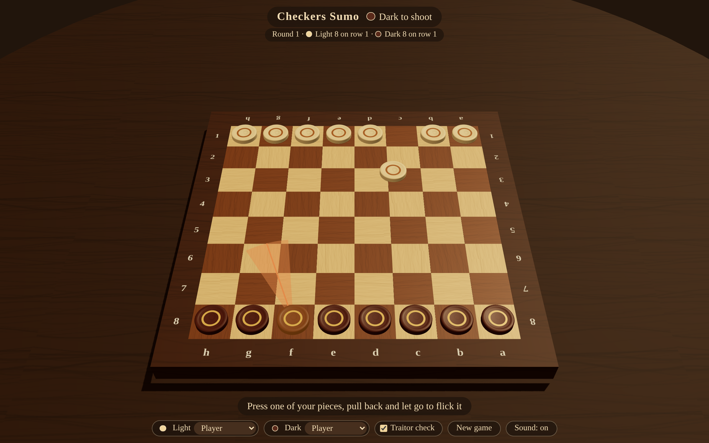
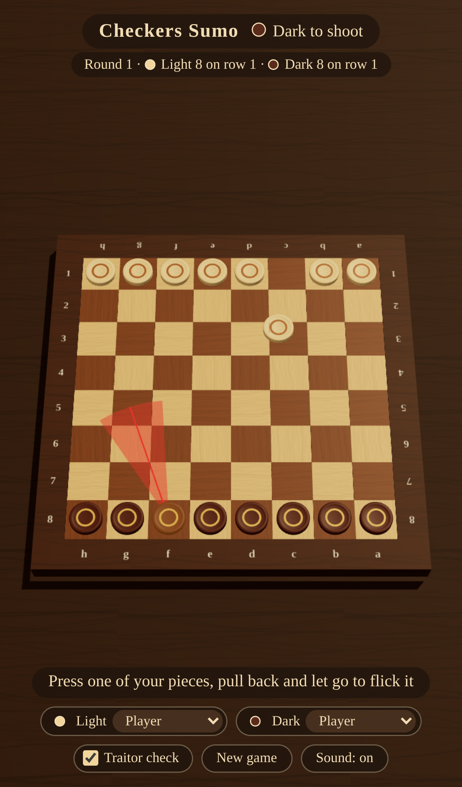
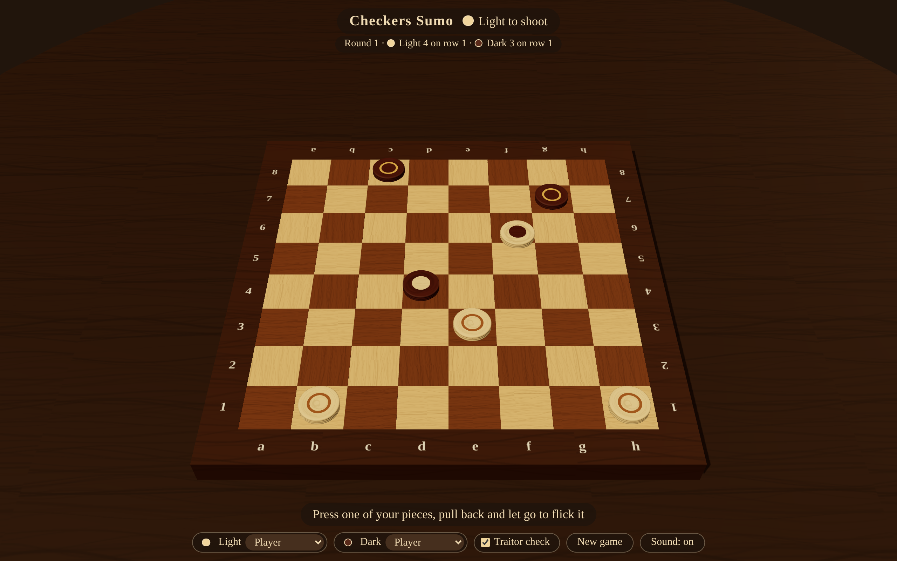

# Checkers Sumo

Flick your checkers to knock your opponent's off the board. A browser board game,
rendered in 3D with [three.js](https://threejs.org/).

**Play it:** https://templarrr.github.io/checkers_sumo/ (once GitHub Pages is switched on, see
[Deploying](#deploying-to-github-pages))





## Rules

- Each side has 8 checkers. In the first round Light lines up on its back row and Dark on the
  opposite back row. Light shoots first.
- On your turn you flick one of your own checkers. The board has a wooden frame around the
  cells; a checker that stops on the frame is still in play. Every checker whose centre ends up
  past the outer edge of the frame falls off and is out of the round.
- A flick never goes exactly where you aimed: it turns by a random angle of up to 5° either way
  for the softest shot, growing to 15° for a full-strength one.
- If your shot knocks off at least one enemy checker and none of your own, you shoot again.
  Otherwise the turn passes to your opponent. Losing one of your own checkers in the traitor
  check below, or seeing one turn traitor, also passes the turn.
- The round ends when only one colour is left on the board. The winner's checkers line up one
  row further forward and the loser stays where they were; the loser shoots first in the next
  round.
- Once the two lines would meet, winning a round still moves you forward one row, and the loser
  is pushed back one row instead.
- When the loser has no row left to be pushed back to, the winner has crossed the whole board
  and wins the game.
- If both sides lose their last checker in the same shot, nobody wins the round and it is
  replayed from the same rows; the side that did not take that shot starts.

### Traitor check (optional, on by default)

Checkers slide flat, so a shot alone never flips one over. But a checker can end a shot hanging
over the edge of the board without falling off, and then, before the next shot, it goes through
a traitor check. Untick **Traitor check** at the bottom of the screen to play without it.



- A checker counts as hanging over the edge when it sticks out past the frame by more than
  1/16 of its width (about a finger's tip), with its centre still on the board.
- Each such checker, one after another, is flicked up from under its overhanging rim. It spins
  through 2 to 10 half-flips, each count equally likely, and comes down somewhere else: the
  harder the flick, the more it spins and the further it drifts. It drifts back over the board
  more often than not, since the flick comes from outside, but it can go up to 135° either side
  of straight in, so it can also fly back out.
- If it comes down past the edge, it is out. If it comes down hanging over the edge again, it is
  flicked again.
- If it comes down on the board the same way up, nothing changes. If it comes down flipped over,
  it is a **traitor** and plays for the other side from then on: it can be flicked by that side,
  counts as one of their checkers and wins rounds for them. The underside of every checker has a
  heart of the other side's wood, so a traitor shows it. A traitor flipped over again goes back
  home to its own side.
- Any checker it comes down on is crushed and leaves the board.
- The odds depend on how far the checker hangs out. One that only just sticks out is lost about
  1 time in 6, turns about 2 in 5 and stays as it was otherwise; one about to fall is lost
  4 times in 10 and turns 3 in 10.
- Every round starts with every checker the right way up.

Not included (yet): regional variants like "scissors" or stacking a second checker.

## How to play

- Press one of your checkers, pull back like a slingshot and let go. The sector in front of the
  checker shows every direction the shot may take; the further you pull, the harder the shot
  and the longer, wider and redder the sector.
  Let go close to the checker, or press Escape, to cancel.
- Drag anywhere else to orbit the camera, scroll or pinch to zoom. After each turn the camera
  swings round to the side that shoots next, so two players can share one screen.
- Pick who plays each side in the boxes at the bottom: a person, or the Easy, Medium or Hard
  bot. Two people share one screen (hot seat), and two bots can play each other while you
  watch. Changing either box starts a new game, and the choice is remembered next time. The
  camera stays behind the side a person plays; with two people or two bots it follows whoever
  shoots.
- The line under the title shows the round and how many checkers each side has left on which
  row.

## Development

You need [Node.js](https://nodejs.org/) 22.12 or newer (`.nvmrc` pins the version).

```sh
npm install
npm run dev      # local server with live reload, open the URL it prints
npm test         # unit tests (Vitest)
npm run lint     # ESLint + Prettier check
npm run format   # fix lint and formatting issues
npm run check    # lint, test and build, the same steps CI runs
```

### Screenshots

The images in `docs/screenshots/` are shown in this README and in pull requests. Whenever the
look or the UI changes, regenerate them in the same change so they stay up to date:

```sh
npx playwright install chromium   # once, downloads the browser the script drives
npm run screenshots               # builds the game and rewrites docs/screenshots/*.png
```

Code style is enforced with [ESLint](https://eslint.org/) for code quality and
[Prettier](https://prettier.io/) for formatting; CI fails a pull request that does not pass
`npm run lint`.

### Code layout

- `src/game/`: the game itself, with no rendering. `physics.js` plays out a flick
  deterministically (sliding friction, checker collisions, falling off the edge); `rules.js`
  turns the result into the game rules: whose turn it is, rounds, rows and the winner;
  `traitors.js` runs the traitor check.
- `src/render/`: three.js scene, board, checkers, shot replay and the slingshot aiming.
- `src/players/`: who chooses the shots: the human (one instance serves both sides in hot seat)
  and the bots.
- `src/audio/`: collision and landing sounds, synthesised with Web Audio.

### Computer players

A player is any object with `chooseShot(state)` returning a promise of
`{ pieceId, vx, vz }` (the velocity it aims for, in squares per second) and an optional
`cancel()`. The random deviation is added afterwards by `playShot`, so it applies to bots too.
Players are wired up in the `PLAYERS` map in `src/main.js`.

Both bots (`src/players/bot.js`) try every shot on a grid of directions and power steps,
keep only the ones that would run straight into a piece and are strong enough to reach it,
play each one out with `simulateShot` and pick the best score: enemy checkers knocked off minus
their own lost, with a tiny bonus for enemy checkers left near the edge to break ties. With
the traitor check on, a checker left hanging over the edge counts as most of a checker lost to its
side: the bots know the odds of the check and count a turned checker twice, once lost and once
gained by the other side. They do not foresee checkers crushed by a landing.

- **Easy** tries 5° and 25% power steps, only aims straight at enemy checkers and assumes every
  shot goes exactly where it aims. Its chosen aim is then turned by a random angle of up to 5°
  either way, before the usual scatter every shot gets.
- **Medium** tries 1° and 10% power steps, also aims at its own checkers to push enemies behind
  them, and scores each shot by the average of 10 imagined shots, each scattered like a real one.
- **Hard** tries the same shots as Medium, but imagines each one 9 times at evenly spaced angles
  across its whole spread, both edges and the middle included, and scores it by the worst of
  them. It passes on shots that only work with luck.

Once the opponent has a single checker left, Medium and Hard only consider shots straight at
it. Nudging their own checkers about and waiting for the opponent to miss would win more often,
but it drags every round out.

Medium and Hard try well over 100,000 shots on a full board, so the search runs in Web Workers
(`src/players/botPlayer.js`), split across the CPU's cores, and the page keeps animating while a
bot thinks.

To compare bots, `npm run tournament -- 50 medium easy` plays 50 games between them without
rendering, alternating who shoots first, and prints the wins for each. It uses every CPU core
and takes a while: a Medium vs Easy game is a few minutes of search on one core.

## Deploying to GitHub Pages

The workflow in `.github/workflows/deploy.yml` lints, tests, builds and publishes the game on
every push to `main`. GitHub needs to be told once to accept that:

1. Open the repository on GitHub and go to **Settings → Pages**.
2. Under **Build and deployment → Source**, pick **GitHub Actions**.
3. Merge the pull request (or push to `main`). The **Deploy to GitHub Pages** workflow runs on
   the **Actions** tab; when it turns green, the game is live at
   https://templarrr.github.io/checkers_sumo/.

If the workflow ran before step 2, re-run it from the **Actions** tab (open the run and choose
**Re-run all jobs**, or use **Run workflow** on the workflow page).
